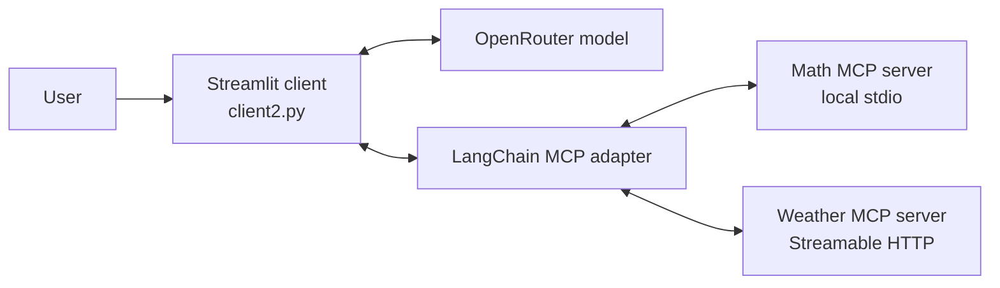

# MCP Chatbot

A Python chatbot project that connects language models to tools exposed by
Model Context Protocol (MCP) servers. It includes a Streamlit chat interface,
a command-line client, and a local calculator MCP server.

## Architecture



The clients discover MCP tools, let the language model choose tools when
needed, execute those tools through the MCP adapter, and return the results
to the model for its response.

## Components

- `src/mcp_chatbot/server.py` provides the local calculator tools: `add`,
  `subtract`, `multiply`, and `divide`.
- `src/mcp_chatbot/client2.py` is the Streamlit chatbot. It uses OpenRouter,
  starts the local calculator server over stdio, and connects to the configured
  online weather server over Streamable HTTP. Tool calls and results are shown
  in the chat.
- `src/mcp_chatbot/client1.py` is a command-line example using Groq. It
  connects to the calculator and a Manim MCP server.

## Requirements

- Python 3.12 or later
- [`uv`](https://docs.astral.sh/uv/)
- API keys for the client you intend to run:
  - `OPENROUTER_API_KEY` for the Streamlit client
  - `GROQ_API_KEY` for the command-line client
- Internet access for the model provider and the online weather MCP server

Create a `.env` file in the project root:

```dotenv
OPENROUTER_API_KEY=your-openrouter-api-key
OPENROUTER_MODEL=openai/gpt-oss-120b

GROQ_API_KEY=your-groq-api-key
GROQ_MODEL=openai/gpt-oss-120b
```

The model variables are optional; each client uses the shown model as its
default. Keep `.env` private and do not commit API keys.

## Install and run

From the project root:

```powershell
uv sync
```

Run the Streamlit chatbot:

```powershell
uv run streamlit run src/mcp_chatbot/client2.py
```

Run the command-line client:

```powershell
uv run python src/mcp_chatbot/client1.py
```

`client1.py` currently expects the Manim MCP server at a machine-specific path
in `LOCAL_SERVERS`. Update that path to your Manim server checkout or remove
that server entry if you only want to use the calculator.

To run only the local calculator MCP server for development:

```powershell
uv run fastmcp dev inspector src/mcp_chatbot/server.py
```